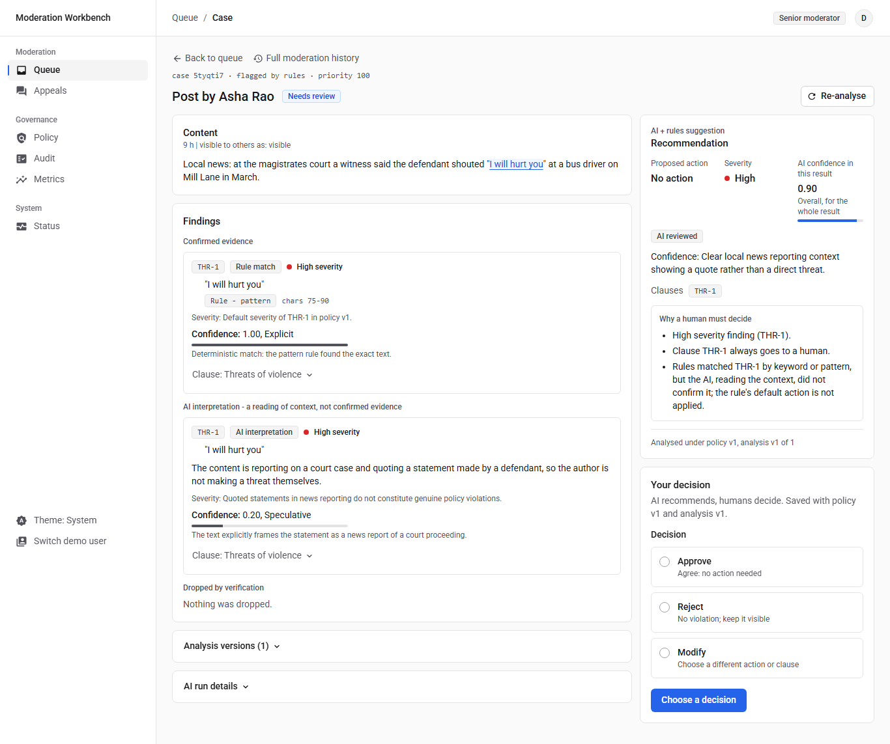
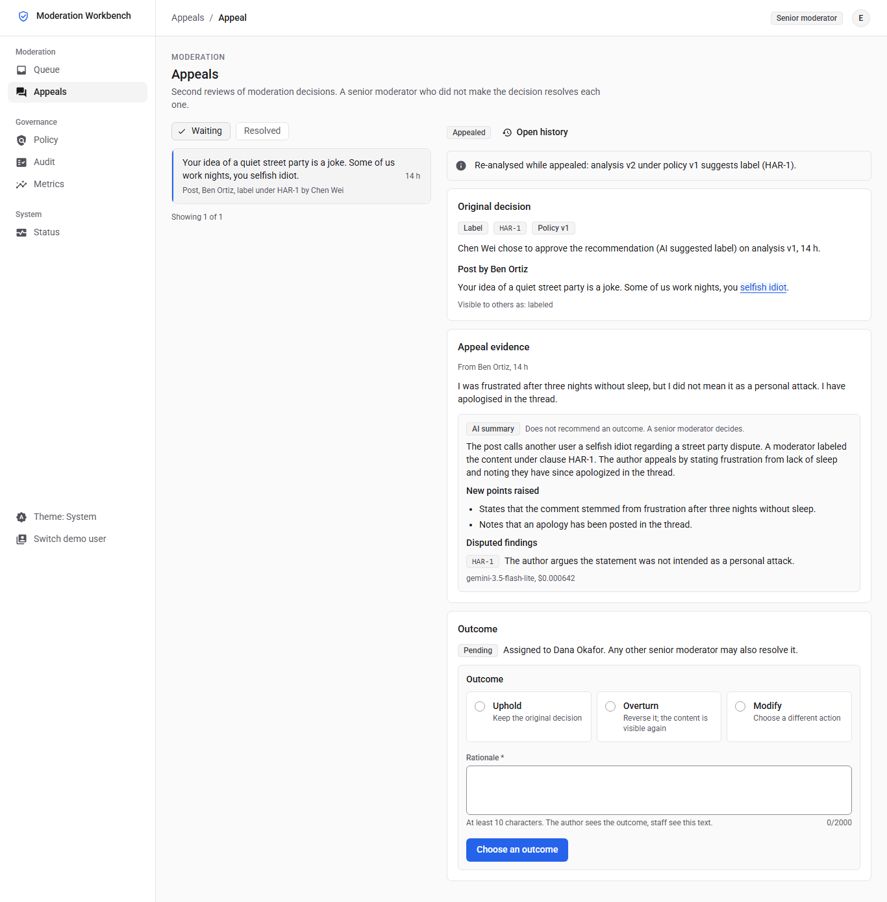
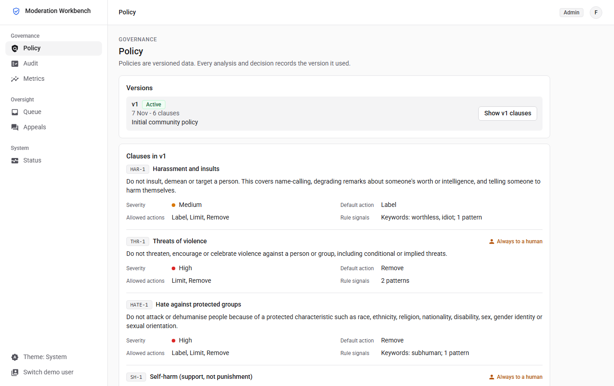
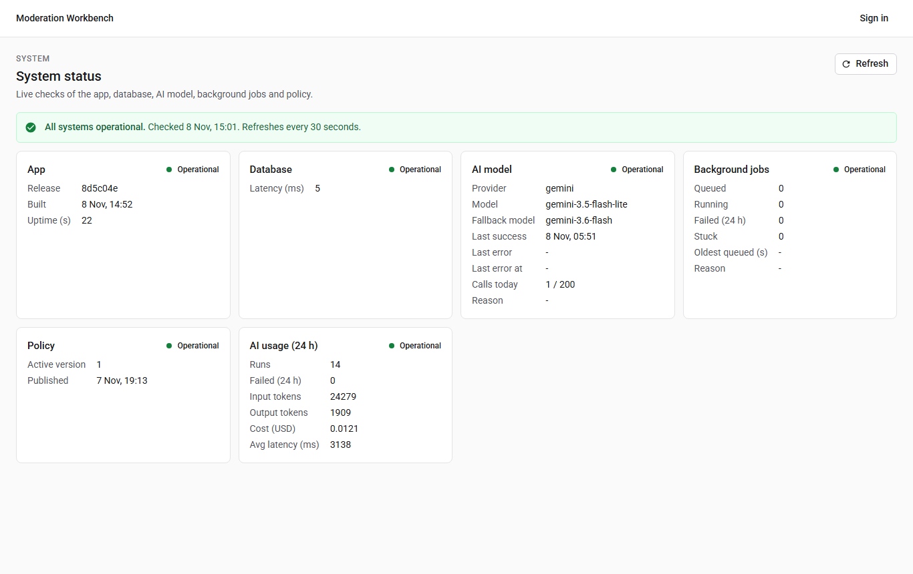
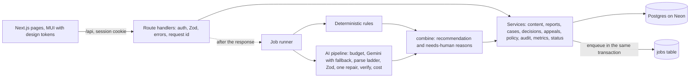

# Content Moderation and Appeals Workbench

[](https://github.com/DeepakMeena77/moderation-workbench/actions/workflows/ci.yml)

A text moderation app where deterministic rules and an AI reviewer check posts and comments against a
versioned policy, and **humans make every moderation decision**. Authors can appeal; appeals go to a different senior
moderator. Every state change is written to a tamper-evident audit trail.

> **The AI recommends; humans decide.** Only one function can change what users see, and it refuses any actor
> that is not a human moderator. A database trigger adds defence in depth: it rejects a visibility change unless the
> transaction names an actor whose stored role is moderator or senior moderator. The AI cannot label, limit or remove content, or resolve an
> appeal. The only thing that happens without a person is **auto-clear**: a case with no rule or AI findings, no
> reports and AI confidence of at least 0.85 is closed as "auto-cleared" without changing what anyone sees. It can
> be turned off with `AUTO_CLEAR_ENABLED=false`, and a moderator can reopen any auto-cleared case.

| | |
| --- | --- |
| Live app | https://moderation-workbench.vercel.app |
| System status | https://moderation-workbench.vercel.app/status (public) |
| Demo sign-in | One click on the sign-in page, or any demo email below with password `Review-Demo-2026` (test accounts only) |

## 5-minute demo

| Step | Sign in as | Do |
| --- | --- | --- |
| 1 | `author@example.com` | Feed: post `You are a worthless idiot and everyone hates you.` It shows "Analysing..." while the rules and Gemini review it. |
| 2 | `senior@example.com` | Queue: open the new case. The quote is highlighted, the clause is cited, and "Why a human must decide" lists the reasons. Approve, modify or reject. |
| 3 | `author@example.com` | My content: the post shows the decision in plain words. Appeal it with a statement of 20+ characters. |
| 4 | `senior@example.com` | Open the appeal: you made the original decision, so the review controls are off and the API refuses a resolve with `SAME_REVIEWER`. Refusals are written to the audit trail. |
| 5 | `senior2@example.com` | Appeals: open it, read the AI's neutral summary (its output has no outcome field and the prompt forbids recommending one), then uphold, overturn or modify. |
| 6 | `admin@example.com` | Policy: upload [policies/policy.v2.json](policies/policy.v2.json), review the clause diff and impact, and publish; unresolved cases are re-analysed with progress (the waiting crypto post, which v1 does not cover, is then cited under the new SCAM-1). Audit: the chain shows "intact". Metrics: agreement, overrides, failures, latency and cost. |
| 7 | anyone | `/status`: app, database, AI model, jobs, policy and AI usage, checked live. |

Demo accounts: `author@`, `author2@`, `moderator@`, `senior@`, `senior2@`, `admin@` (all `@example.com`).

## What it does

- **Content:** posts, comments and user reports, with a moderation history per item.
- **Deterministic checks:** policy keywords and patterns, link count, contact details and repeat posting, with
  exact character offsets.
- **AI review (Gemini):** cites the exact clause behind every finding, separates confirmed evidence (verbatim
  quotes, verified by code) from interpretation, proposes an action, explains severity and confidence, and says
  when human judgement is needed. The **server** makes the final "needs a human" call from 15 explicit reasons.
- **Human decisions:** approve, reject or modify the recommendation, with the policy version stored on every
  decision and protection against deciding on an outdated analysis (409).
- **Appeals:** author only, once, within 14 days; routed to a senior moderator who did not make the decision; the
  page shows the original decision, the appeal evidence, a neutral AI summary and the final outcome.
- **Policy versions:** compare, publish (admin), and re-evaluation of every unresolved case as a new analysis
  version, with progress and retry. Decided items show "Policy changed since this decision (v1 -> v2)".
- **Audit:** append-only, hash-chained events written in the same transaction as each change, with an integrity
  check; refused API calls and refused pages are recorded as `access.denied`.
- **Operations:** a public status page that checks the whole journey, an admin jobs panel (run pending jobs,
  retry failed ones), structured logs with request IDs, and a metrics page (AI vs human agreement, override
  reasons, failures, latency, cost, and how many auto-cleared cases were later reported or reopened).

## Requirements and evidence

Every acceptance criterion in [docs/01-requirements.md](docs/01-requirements.md) has an ID, and tests carry the
ID in their name. `npm run check:trace -- --strict` maps each criterion to its tests and writes
[docs/trace.md](docs/trace.md): 65 of 70 criteria are covered by tests, and the other 5 are checked by hand.

| Area | Criteria | Evidence |
| --- | --- | --- |
| Content and reports | CNT-1..5 | 5 of 5 covered by tests |
| Deterministic rules | DET-1..5 | 5 of 5 |
| AI review | AI-1..12 | 12 of 12 |
| Human control | HUM-1..7 | 7 of 7 |
| Queue and case review | Q-1..4 | 4 of 4 |
| Appeals | APP-1..5 | 5 of 5 |
| Policy versions | POL-1..5 | 5 of 5 |
| Audit | AUD-1..5 | 5 of 5 |
| Security | SEC-1..5 | 5 of 5 |
| UI and UX | UX-1..5 | 5 of 5 |
| Operations | OPS-1..6 | 5 of 6; OPS-5 (deployment) in [docs/RELEASE_NOTES.md](docs/RELEASE_NOTES.md) |
| Evaluation | EVAL-1..2 | 2 of 2 |
| Documents and CI | DOC-1..4 | By hand: these documents and [.github/workflows/ci.yml](.github/workflows/ci.yml) |

## Screenshots

Taken from the live deployment (light theme; dark theme follows the system setting or the toggle).

| Case review | Appeal review |
| --- | --- |
|  |  |
| **Policy** | **System status** |
|  |  |

More in [docs/screenshots](docs/screenshots): sign-in, feed, my content, case review on a phone, audit and metrics.

## Architecture



| Layer | Path | Rule |
| --- | --- | --- |
| Pages and UI | `src/app`, `src/ui` | Call `/api` only |
| Route handlers | `src/app/api` | Auth, validation and error mapping; one service call |
| Services | `src/server/services` | Business rules, transactions, audit; never call the model |
| Moderation core | `src/server/rules`, `src/server/ai`, `src/server/moderation` | Pure logic and the AI pipeline; cannot import visibility or decisions (lint + test) |
| Jobs | `src/server/jobs` | Database-backed queue (SKIP LOCKED, lease, retries); the only place the model is called |

Design decisions are recorded in [docs/02-system-design.md](docs/02-system-design.md) (section 12). The UI
follows the design system in [docs/03-ui-ux.md](docs/03-ui-ux.md): neutral surfaces with 1 px hairlines, one
accent colour, colour only where it carries meaning, no elevation or gradients, and a navigation bar, rail or
sidebar by width.

## AI

See [AI_NOTES.md](AI_NOTES.md) for the model choice, every safeguard with its file and test, the bounds, cost
and the evaluation results, and [PROMPTS_USED.md](PROMPTS_USED.md) for the runtime prompts and how they were
refined.

Evaluation (`npm run eval`, 21 labelled cases, live `gemini-3.5-flash-lite`, classify prompt v2, three runs):
19-20/21 pass, 100% clause recall, 100% must-escalate recall, exact action agreement 16-17/18, no false escalation
on clean posts, 0 invalid outputs, about 0.022 USD per run. Clause precision is 100% on labelled codes and 69-79%
strict, where every unexpected citation counts against it. Prompt v1, kept for comparison, scored 19/21, 69% strict
and 15/18 in each of its three runs (PROMPTS_USED.md sec. 3.5).

## Setup

Requirements: Node.js 22 (`.nvmrc`) and a Postgres database (Neon was used).

```bash
npm ci
cp .env.example .env          # fill DATABASE_URL, DIRECT_URL, SESSION_SECRET, DEMO_PASSWORD, GEMINI_API_KEY
npx prisma migrate deploy
npm run db:seed               # demo users and policy v1
npm run dev                   # http://localhost:3000
```

`AI_PROVIDER` defaults to `mock`, a deterministic provider that needs no key. For live AI set `AI_PROVIDER=gemini`,
`GEMINI_API_KEY` and the two `AI_PRICE_*` values.

Integration tests use a separate database in `.env.test` with `TEST_DATABASE=true`; the test setup refuses to run
without it, because it empties every table.

## Tests

| Command | What runs |
| --- | --- |
| `npm run verify` | Repo guard, ASCII check, UI-rule check, ESLint and Prettier, typecheck, unit, integration and component tests |
| `npm run test:ui` | Playwright: axe accessibility in light and dark, no horizontal scroll from 320 to 1920 px, navigation variants, a style audit of the design system, readable copy on every page |
| `npm run test:e2e` | The cross-role journey: post, review, decide, appeal, refused self-review, second review, audit and metrics, at 1280 and 390 px |
| `npm run eval` | The AI evaluation (live; `-- --mock` offline, as in CI) |
| `npm run check:trace` | Acceptance criterion to test mapping |

CI (GitHub Actions) runs verify and the mock evaluation on a Postgres service, then builds, seeds, and runs the UI
suite and the end-to-end journey.

## Scope

**Built:** everything in the problem statement and [docs/01-requirements.md](docs/01-requirements.md), except what
is listed under limitations.

**Out of scope (as stated in the brief):** image or video moderation, real social-network integration,
automated account bans, unrestricted user-generated content (text only, 2,000 characters, no HTML).

**Chosen exclusions:** self-service sign-up and password reset (seeded demo accounts), editing or deleting
content (evidence stays stable), notifications, real-time push (pages poll while work is pending).

## Known limitations

- When the model treats a keyword or pattern hit as interpretation only, that hit adds no action, so a genuine
  threat the model misreads would be recommended as "none". It is never actioned that way: the case always goes
  to a human with the hit, its high severity and the reason shown. Capping such hits at the clause's mildest
  action instead would bring back "limit" for quoted news (E09); the evaluation favoured "none".
- The appeal brief's output has no outcome field, its prompt forbids recommending one, and its summary is scanned
  for recommending language in the model's own voice (a match shows a warning on the appeal page). A reworded
  recommendation could still slip past the pattern; a senior moderator decides either way.
- The audit chain detects a changed or rewritten row and a row removed from the middle of the chain. Rows are
  insert-only by trigger, so removing any row needs the table owner to bypass the trigger; rows removed from the
  end, a `TRUNCATE` (the integration tests reset tables this way) or an empty chain still verify as intact. An
  external anchor of the latest hash would close that gap; the app's own code never deletes or truncates.
- The single repair call goes through the same provider chain, so a transient error during repair is retried
  within the same bounds. Tokens and cost are recorded from responses that report usage; an attempt that times
  out reports none.
- Deterministic threat patterns cannot tell a quotation from a threat (evaluation case E09). Such cases still go
  to a human; no action is taken automatically.
- The AI over-flags some friendly banter as possible harassment (label only, sent to a human).
- Model prices are configuration copied from Google's published list on 2026-11-08; the fallback model's price
  doubles on 2027-01-01, and `AI_PRICE_FALLBACK_*` must be updated then.
- The Gemini free tier has small quotas; a daily AI call budget and a fallback model reduce, but do not remove,
  "AI unavailable" periods. Rule findings still reach a human in that state.
- The audit integrity check walks the whole chain on each audit page load; fine at demo scale, and a stored
  checkpoint would be the next step for a large trail.
- AI pacing (the minimum gap between model calls) is per serverless instance; rate limits are shared, because
  they are counted in the database.
- English only; other languages are sent to a human.

## Deployment

Vercel (region `sin1`) with Neon Postgres (Singapore). Production and preview use separate database branches;
the build runs `prisma generate && prisma migrate deploy && next build`. Pushes to `main` deploy production.

Post-deploy verification of the current release: `/api/health` reports the deployed commit; `/status` shows all
six checks operational; the audit chain verifies as intact; live Gemini runs are recorded with tokens and cost;
CI is green on the commit. The full record, with numbers, is in [docs/RELEASE_NOTES.md](docs/RELEASE_NOTES.md).

## Documents

| File | Purpose |
| --- | --- |
| [docs/01-requirements.md](docs/01-requirements.md) | Numbered acceptance criteria |
| [docs/02-system-design.md](docs/02-system-design.md) | Architecture, data model, AI pipeline, API, decisions |
| [docs/03-ui-ux.md](docs/03-ui-ux.md) | Design system and screens |
| [docs/00-process.md](docs/00-process.md) | How the work was organised: slices, gates, git workflow |
| [docs/04-build-plan.md](docs/04-build-plan.md) | Slice plan with scope and exit checks |
| [docs/05-test-plan.md](docs/05-test-plan.md) | Test strategy and evaluation set |
| [docs/trace.md](docs/trace.md) | Generated criterion-to-test table |
| [AI_NOTES.md](AI_NOTES.md) | AI design, safeguards, cost, evaluation |
| [PROMPTS_USED.md](PROMPTS_USED.md) | Runtime prompts and refinements |
| [AGENT_USAGE.md](AGENT_USAGE.md) | How coding agents were used and checked |
| [ABOUTME.md](ABOUTME.md) | About the author |
